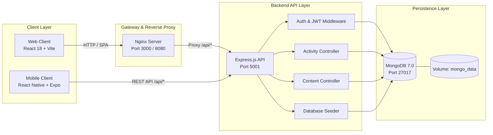
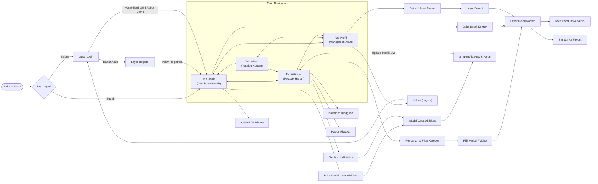

# HealthyLife Platform

HealthyLife adalah platform gaya hidup sehat modern dan terintegrasi yang dirancang untuk membantu pengguna memantau kebugaran harian, mencatat aktivitas fisik serta hidrasi, dan mengakses artikel maupun panduan video kesehatan terpercaya.

Platform ini hadir sebagai ekosistem lengkap yang terdiri dari **REST API Service**, **Web Client**, dan **Mobile Client (React Native / Expo)** yang saling terhubung secara *real-time*.

---

## Features

### 1. Infrastructure Features
* **Zero-Configuration Deployment (Docker Compose):**
  * Menjalankan seluruh ekosistem server (MongoDB, Express Backend, dan Frontend Nginx) hanya dengan satu perintah tanpa instalasi dependensi manual.
  * **Built-in Auto-Seeder:** Database otomatis terisi data awal (artikel kesehatan, video olahraga, metrik harian, serta akun demo Budi) saat pertama kali container dijalankan.
  * **Reverse Proxy Nginx Terintegrasi:** Menghubungkan client web dan API internal secara otomatis tanpa kendala CORS.
  * **Zero Manual Environment Setup:** Konfigurasi variabel lingkungan default sudah tertanam otomatis di dalam container.

### 2. Application Features
* **Autentikasi & Personalisasi Akun:**
  * Pendaftaran akun baru dan login aman berbasis token JWT (*JSON Web Token*) dengan enkripsi password menggunakan Bcrypt.
  * Fitur **"Isi Otomatis Akun Demo"** untuk masuk secara instan tanpa perlu mengetik manual.
* **Dashboard & Pelacak Metrik Harian:**
  * Pemantauan progres target harian (misal target 10.000 langkah).
  * 4 metrik kesehatan utama: Jumlah Langkah, Kalori Terbakar (kkal), Hidrasi Air Minum (ml), dan Waktu Olahraga Aktif (menit).
  * Tombol aksi cepat tambah air minum (+250 ml) langsung dari dashboard.
* **Activity Logger:**
  * Modal pencatatan aktivitas terpadu untuk berbagai jenis olahraga (Lari, Bersepeda, Senam, Jalan Santai, dll.).
  * Input durasi, jarak, dan perkiraan kalori terbakar yang otomatis memperbarui akumulasi metrik harian.
  * Riwayat log aktivitas terurut secara kronologis.
* **Eksplorasi Konten & Edukasi Kesehatan:**
  * Katalog artikel dan video edukasi kesehatan, nutrisi seimbang, resep makanan sehat, dan panduan latihan kardio/kekuatan.
  * Filter berdasarkan kategori konten dan pencarian dinamis.
* **Detail Konten Lengkap:**
  * Pembacaan artikel komprehensif, video playback edukatif, ringkasan nutrisi makro/mikro, serta panduan praktis gaya hidup sehat.
* **Manajemen Koleksi Favorit:**
  * Pengguna dapat menyimpan artikel atau video favorit dengan satu klik untuk dibaca kembali kapan saja melalui menu/tab Favorit.
* **Sinkronisasi Multi-Platform:**
  * Seluruh aktivitas, metrik harian, dan koleksi favorit tersinkronisasi secara langsung antara aplikasi Web dan aplikasi Mobile.

---

## System Architecture

Platform HealthyLife dibangun menggunakan arsitektur modular client-server yang tangguh, di mana frontend web dan mobile berkomunikasi ke backend melalui protokol RESTful API:



---

## User Flow

Diagram berikut memetakan perjalanan pengguna (*user journey*) dari proses autentikasi awal, navigasi 4 tab utama, hingga interaksi konten dan pencatatan aktivitas:



---
## Project Tree

```text
HealthyLife/
├── backend/                        # REST API Service (Node.js & Express)
│   ├── src/
│   │   ├── config/                 # Konfigurasi koneksi database MongoDB
│   │   ├── controllers/            # Controller logika bisnis (auth, activity, content, favorite)
│   │   ├── middleware/             # Middleware autentikasi JWT dan penanganan error terpusat
│   │   ├── models/                 # Model Mongoose (User, Activity, Content, DailyMetric, Favorite)
│   │   ├── routes/                 # Definisi route endpoint API
│   │   ├── seeds/                  # Data awal (artikel, video edukasi, akun demo Budi)
│   │   └── utils/                  # Utilitas kalkulasi dan format tanggal
│   ├── tests/                      # Pengujian integrasi API otomatis
│   ├── .dockerignore
│   ├── .env.example                # Template variabel lingkungan backend
│   ├── Dockerfile                  # Container build backend Node.js
│   ├── package.json
│   └── server.js                   # Entry point HTTP server backend
│
├── frontend/                       # Client Web SPA (React 18 & Vite)
│   ├── public/                     # Asset statis, favicon, dan ilustrasi lokal
│   ├── src/
│   │   ├── components/             # Komponen UI modular (Sidebar, BrandLogo, ActivityModal, dll.)
│   │   ├── context/                # Context provider (AuthContext, FavoritesContext)
│   │   ├── pages/                  # Halaman web (Dashboard, Explore, Detail, Activities, Favorites, Auth)
│   │   ├── services/               # HTTP client Axios & manajemen token session
│   │   └── utils/                  # Utilitas format teks dan tanggal
│   ├── .dockerignore
│   ├── .env.example                # Template variabel lingkungan frontend
│   ├── Dockerfile                  # Multi-stage build Nginx & Vite
│   ├── nginx.conf                  # Konfigurasi reverse proxy Nginx
│   ├── package.json
│   ├── tailwind.config.js
│   └── vite.config.js
│
├── mobile/                         # Client Mobile (React Native & Expo)
│   ├── assets/                     # Splash screen, icon aplikasi, dan gambar lokal
│   ├── src/
│   │   ├── components/             # Komponen visual mobile (BrandLogo, ActivityModal)
│   │   ├── context/                # AuthContext untuk manajemen sesi pengguna
│   │   ├── navigation/             # AppNavigator (Auth) & TabNavigator (Main Tabs)
│   │   ├── screens/                # Layar mobile (Home, Explore, Detail, Activities, Favorites, Profile, Auth)
│   │   ├── services/               # API service & dynamic base URL resolver
│   │   └── theme/                  # Skema warna, typography, dan asset resolver
│   ├── .env.example                # Template variabel lingkungan mobile
│   ├── app.json                    # Konfigurasi metadata Expo
│   ├── babel.config.js
│   ├── package.json
│   └── App.js                      # Root component aplikasi mobile
├── docker-compose.yml              # Orkestrasi container MongoDB, Backend, dan Web Frontend
├── netlify.toml                    # Konfigurasi build & routing monorepo Netlify
├── .env.example                    # Template override variabel lingkungan root / Docker
├── .gitignore                      # Filter berkas yang diabaikan git
└── README.md                       # Dokumentasi utama proyek
```

---

## Environment Variables

Secara default, Docker Compose sudah memiliki konfigurasi mandiri. Seluruh nilai konfigurasi dapat di-override dengan membuat berkas `.env` di root proyek (misal saat menghubungkan backend ke MongoDB Atlas di VPS):

### 1. Docker Compose Override (`.env`)

Salin dari `.env.example`:
```bash
cp .env.example .env
```

| Variabel | Deskripsi | Default / Rekomendasi |
| :--- | :--- | :--- |
| `PORT` | Port server HTTP backend | `5001` |
| `MONGODB_URI` | URI koneksi MongoDB (Lokal atau Cloud Atlas) | `mongodb+srv://<user>:<password>@cluster0.mongodb.net/healthylife` |
| `JWT_SECRET` | Kunci rahasia untuk token autentikasi JWT | `healthylife_jwt_secret_key_super_secure_2026` |
| `NODE_ENV` | Mode lingkungan aplikasi | `production` atau `development` |

> **Catatan MongoDB Atlas & VPS:** Layanan `backend` di `docker-compose.yml` telah dirancang independen tanpa ketergantungan (`depends_on: mongo`). Anda dapat langsung menjalankan `docker compose up -d backend` di VPS dan menghubungkannya ke MongoDB Atlas tanpa perlu menjalankan container database lokal.

### 2. Backend (`backend/.env`)

Salin dari `backend/.env.example`:
```bash
cp backend/.env.example backend/.env
```

| Variabel | Deskripsi | Default / Rekomendasi |
| :--- | :--- | :--- |
| `PORT` | Port server HTTP backend | `5001` |
| `MONGODB_URI` | URI koneksi database MongoDB | `mongodb://localhost:27017/healthylife` (lokal) atau `mongodb://mongo:27017/healthylife` (Docker) |
| `JWT_SECRET` | Kunci rahasia untuk tanda tangan token JWT | `healthylife_jwt_secret_key_super_secure_2026` |
| `NODE_ENV` | Mode lingkungan aplikasi | `development` atau `production` |
| `APP_TIMEZONE` | Zona waktu aplikasi | `Asia/Jakarta` |
### 3. Frontend (`frontend/.env`)

Salin dari `frontend/.env.example`:
```bash
cp frontend/.env.example frontend/.env
```

| Variabel | Deskripsi | Default / Rekomendasi |
| :--- | :--- | :--- |
| `VITE_BACKEND_URL` | Target server backend untuk reverse proxy Vite dev-server | `http://127.0.0.1:5001` |
| `BACKEND_URL` | Target backend VPS untuk reverse proxy Netlify | `http://<IP_VPS_ANDA>:5001` |
| `VITE_API_URL` | Base path API yang dipanggil oleh Axios di browser | `/api` |
### 4. Mobile (`mobile/.env`)

Salin dari `mobile/.env.example`:
```bash
cp mobile/.env.example mobile/.env
```

| Variabel | Deskripsi | Default / Rekomendasi |
| :--- | :--- | :--- |
| `EXPO_PUBLIC_API_URL` | Endpoint REST API yang diakses aplikasi mobile | `http://localhost:5001/api` (Web preview) atau `http://<IP_LAN_KOMPUTER_ATAU_VPS>:5001/api` |

---

## Getting Started

### 1. Docker Compose (Recommended)

Metode Zero-Configuration ini menjalankan MongoDB, Express Backend, dan Frontend Nginx secara terisolasi dan terhubung otomatis.

1. **Jalankan seluruh layanan:**
   ```bash
   docker compose up --build -d
   ```

2. **Akses layanan melalui browser:**
   * **Aplikasi Web:** [http://localhost:3000](http://localhost:3000)
   * **Backend API Health Check:** [http://localhost:5001/api/health](http://localhost:5001/api/health)
3. **Akun Uji Coba (Demo User):**
   * **Email:** `budi@healthylife.com`
   * **Password:** `password123`
   * *(Tersedia tombol "Isi Otomatis Akun Demo" di layar Login untuk kemudahan autentikasi)*

4. **Perintah manajemen container:**
   ```bash
   # Melihat status container
   docker compose ps

   # Melihat log container secara langsung
   docker compose logs -f

   # Menghentikan dan membersihkan container
   docker compose down -v
   ```

---
### 2. Local Development (Manual)

Gunakan metode ini jika Anda ingin melakukan kustomisasi atau pengembangan kode secara langsung di mesin lokal.

#### Prasyarat
* Node.js (v18 atau lebih baru) & npm
* MongoDB Server aktif di `mongodb://localhost:27017`

#### 1. Menjalankan Backend API
```bash
cd backend
npm install
npm run dev
```
Backend akan berjalan di [http://localhost:5001](http://localhost:5001). Saat pertama kali berjalan, seeder otomatis akan menginisialisasi database dengan data awal.
#### 2. Menjalankan Frontend Web
Buka terminal baru:
```bash
cd frontend
npm install
npm run dev
```
Frontend web akan berjalan di [http://localhost:3000](http://localhost:3000).

#### 3. Menjalankan Aplikasi Mobile
Buka terminal baru:
```bash
cd mobile
npm install
npx expo start
```
* **Melalui Browser (Web Simulator):** Tekan tombol `w` di terminal untuk membuka pratinjau mobile langsung di browser.
* **Melalui Smartphone (Expo Go):** Buka aplikasi **Expo Go** (Android / iOS), lalu pindai QR code yang tampil di terminal.  
  *(Pastikan smartphone dan komputer berada dalam satu jaringan Wi-Fi yang sama, dan atur `EXPO_PUBLIC_API_URL` pada `mobile/.env` dengan IP LAN komputer Anda).*

---
### 3. Netlify Deployment (Web Frontend)

Jika Anda mendeploy backend di VPS (pada port `5001`) dan ingin mendeploy frontend di Netlify:

1. **Hubungkan Repositori ke Netlify:**
   - Import repositori GitHub `fakhnur/HealthyLife` ke akun Netlify Anda.
   - Berkas `netlify.toml` di root proyek akan otomatis mendeteksi:
     - **Base directory:** `frontend`
     - **Publish directory:** `dist`
     - **Build command:** `npm run build`

2. **Atur Variabel Lingkungan di Netlify Dashboard:**
   - Buka **Site configuration** > **Environment variables**.
   - Tambahkan variabel:
     - **Key:** `BACKEND_URL`
     - **Value:** `http://<IP_VPS_ANDA>:5001` *(ganti `<IP_VPS_ANDA>` dengan alamat IP publik atau domain VPS Anda, tanpa trailing slash)*.

3. **Mekanisme Otomatis Netlify Reverse Proxy:**
   - Saat Netlify menjalankan `npm run build`, sistem secara otomatis mengompilasi berkas `dist/_redirects` dengan aturan:
     ```text
     /api/*  http://<IP_VPS_ANDA>:5001/api/:splat  200!
     /*      /index.html                           200
     ```
   - **Bebas Masalah Mixed Content:** Browser mengakses frontend melalui HTTPS Netlify (`https://site.netlify.app/api/...`), lalu Netlify meneruskannya secara server-to-server ke backend HTTP VPS Anda pada port `5001`.
   - **SPA Routing Aman:** Navigasi client-side tidak akan mengalami error 404 saat halaman di-refresh.

---
### 4. Expo.dev Deployment (Mobile EAS Build)

Aplikasi mobile telah dikonfigurasi dengan `eas.json` dan `app.json` (`usesCleartextTraffic: true` & package ID) sehingga siap dibuild via platform **Expo Application Services (EAS)**:

1. **Persiapan Akun Expo & EAS CLI:**
   ```bash
   npm install -g eas-cli
   eas login
   ```

2. **Inisialisasi Project di Direktori Mobile:**
   ```bash
   cd mobile
   eas project:init
   ```

3. **Build APK Standalone untuk Android (Preview):**
   ```bash
   eas build --platform android --profile preview
   ```
   Setelah proses build di cloud Expo selesai, Anda akan mendapatkan tautan unduhan langsung berupa file `.apk` yang dapat diinstal langsung ke perangkat Android.

4. **Konektivitas ke Backend VPS:**
   Pastikan variabel `EXPO_PUBLIC_API_URL` pada `mobile/.env` atau di dashboard EAS Secrets diarahkan ke backend VPS Anda:
   ```text
   EXPO_PUBLIC_API_URL=http://<IP_VPS_ANDA>:5001/api
   ```
   *(Opsi `usesCleartextTraffic: true` di `app.json` memastikan Android tidak memblokir komunikasi HTTP ke IP VPS Anda).*
